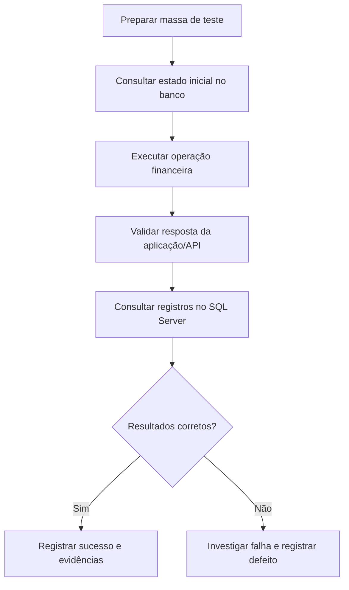

# 🧪 QA Automation | Financial Testing

### Automação de Testes e Validação de Sistemas Financeiros

**Java • Playwright • JUnit 5 • API Testing • SQL Server**

**Desenvolvido por Vanessa Santos | Quality Assurance**

---

## 📌 Sobre o projeto

Projeto de **Quality Assurance e Automação de Testes** desenvolvido para validar operações financeiras, com foco em qualidade de software, confiabilidade dos dados e regras de negócio.

A solução contempla testes de interface Web, integração com serviços SOAP/HTTP e validações em banco de dados SQL Server.

> 🎯 **Objetivo:** garantir que as operações financeiras sejam processadas corretamente, validando os resultados na aplicação, nos serviços e no banco de dados.

---

## 🚀 O que desenvolvi

| Área | Implementação |
|---|---|
| 🌐 Testes Web | Automação de funcionalidades com Java e Playwright |
| 🧪 Testes funcionais | Validação de cenários e regras de negócio |
| 🔗 Testes de API | Integração e validação de serviços SOAP/HTTP |
| 🗄️ Banco de dados | Consultas e validações SQL Server com JDBC |
| 💰 Regras financeiras | Pagamentos, cálculos, quitação e boletos |
| 🏗️ Arquitetura | Page Object Model e organização em camadas |
| 📋 Qualidade | Verificações, resultados e evidências de testes |

---

## 🛠️ Stack tecnológica

### Automação e desenvolvimento

- **Linguagem:** Java 21
- **Automação Web:** Playwright
- **Framework de testes:** JUnit 5
- **Gerenciamento de dependências:** Maven
- **Padrão de projeto:** Page Object Model

### APIs e dados

- **Integração:** SOAP/HTTP
- **Banco de dados:** SQL Server
- **Conectividade:** JDBC
- **Versionamento:** Git e GitHub

### Estratégias de testes

`Testes Funcionais` `Regressão` `Integração` `E2E` `Validação de Regras de Negócio`

---

## 🔄 Fluxo de validação financeira

Esse fluxo representa a abordagem de validação de ponta a ponta utilizada no projeto, desde a preparação dos dados até a análise dos resultados financeiros.

---

## 💰 Cenários financeiros

O projeto aborda validações relacionadas a:

- Pagamento mínimo, parcial e integral.
- Simulação de quitação.
- Geração e validação de boletos.
- Consultas de informações financeiras no banco.
- Comparação de dados antes e depois das operações.
- Validação de regras e cálculos financeiros.

---

## 📂 Estrutura e documentação

| Recurso | Descrição |
|---|---|
| [Código-fonte](./src) | Implementação dos componentes e testes |
| [Workflows](./.github/workflows) | Configurações de automação no GitHub |
| [README técnico](#) | Detalhamento técnico apresentado abaixo |

---

## 👩‍💻 Sobre a desenvolvedora

**Vanessa Santos | Quality Assurance**

Estudante de **Análise e Desenvolvimento de Sistemas**, com previsão de conclusão em 2028.

Experiência prática em testes manuais, automação Web, testes de API e validação de dados com SQL.

Interesse em Quality Engineering, boas práticas de testes, automação e melhoria contínua.

🎯 **Objetivo profissional:** QA Júnior ou Estágio em Quality Assurance.

### 🤝 Vamos nos conectar?

[LinkedIn](https://www.linkedin.com/in/vanessasantos-qa/) • [GitHub](https://github.com/VanessaSantosQA)

**Quality is built, tested and continuously improved.**

---

## 📚 Documentação técnica detalhada

<!-- Mantenha abaixo desta linha o restante da documentação original do projeto. -->
